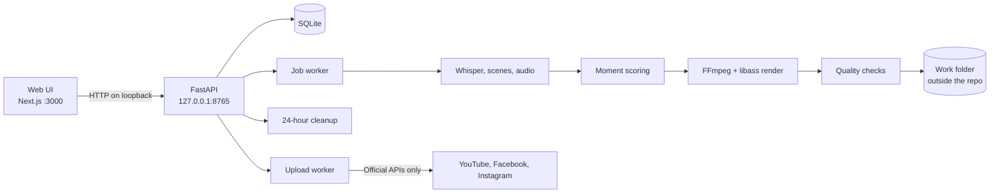

# clipforge

**A local video clip editor that turns long videos you have the rights to into captioned, ready-to-post clips.**

Everything runs on your own computer. Your videos are never sent anywhere unless you press Upload.

<!-- Screenshot placeholder: new job screen -->
<!-- Screenshot placeholder: clips screen -->
<!-- GIF placeholder: word-by-word captions -->

## What it does

Drop in a video of any length. clipforge transcribes it, finds the strongest moments, cuts them at natural boundaries, adds animated word-by-word captions, and exports clips that pass quality checks. You can choose every setting yourself, or let auto mode decide and explain why.

## Features

- **Manual and auto modes.** Manual asks for genre, clip length, count, part numbering, format, ratio and resolution. Auto decides all of them from the content and shows its reasons.
- **Clip finder.** Word timestamps, scene cuts, silences and audio peaks are scored for speech energy, emotion, topic change and visual action. Clips never start or end mid-sentence.
- **Frame-accurate cuts**, down to a single frame, including at 29.97 fps.
- **Caption engine.** One to three words at a time, synced to the audio, with a coloured active word, big emphasis words, small filler words and safe margins for each ratio. Seven presets, plus an editor with a live preview and a real libass render. Works with Latin scripts, Hindi, Japanese, Korean, Chinese, Arabic and Hebrew.
- **Editing.** Clean cuts or crossfades, pause removal, face- and motion-aware vertical reframing, and two-pass loudness normalization to -14 LUFS.
- **Quality checks** on every export: duration, resolution, audio, black frames, frozen video, loudness and peak.
- **Titles and descriptions** generated locally from the transcript, with no network and no AI service.
- **No channel needed.** Make clips first and connect a channel whenever you like.
- **Three clip folders.** Unassigned clips delete themselves after 24 hours, with a visible countdown. Queued clips wait for a channel with the timer paused. Saved clips are kept until you delete them, in a folder you choose. Temp files go right after each render.
- **Channels.** YouTube, Instagram and Facebook, each with its own defaults, and linked channels that can receive the same clip.
- **Official API uploads only**, with a hard stop on copyright claims.

## Current status

Early but working. See [Tested and untested](#tested-and-untested) for exactly what has and has not been proven.

## Tested and untested

**Tested on real runs:** full jobs through the API and web UI with GPU transcription and NVENC, on an owned synthetic sample, including a one-hour video, 12-minute parts, and short 8K renders. A fresh clone installs and passes the same checks.

**Tested only against mocks:** all three platform upload flows. No live upload has ever been made, because that needs your own platform app credentials.

**Not tested:** real anime, film or gameplay footage (auto mode's genre rules are reasoned, not calibrated), a long 8K render, transcription of languages other than English, macOS and non-WSL Linux.

## Tech stack

- **Engine:** Python 3.11+, FFmpeg with libass, faster-whisper, OpenCV, NumPy, SciPy, FastAPI, SQLite
- **Web UI:** Next.js, TypeScript, Tailwind CSS

## Architecture



More detail: [docs/ARCHITECTURE.md](docs/ARCHITECTURE.md).

## Requirements

- WSL2 on Windows, or Linux. Developed on Ubuntu 26.04 under WSL2.
- Python 3.11 or newer (tested on 3.12). [uv](https://docs.astral.sh/uv/) is used when available.
- Node.js 20 or newer.
- FFmpeg with libass. The setup script downloads a static build if none is installed.
- Optional: an NVIDIA GPU for much faster transcription and encoding. Everything also works on CPU.
- Free disk space for the Whisper model (about 1.6 GB), your videos and renders.

## Install

```bash
git clone https://github.com/Himkush1414/clipforge.git
cd clipforge
scripts/setup.sh
```

Everything large goes into `~/clipforge-work`, outside the repo. To put it elsewhere, set `CLIPFORGE_WORK_DIR`. Keep it inside WSL, not under `/mnt`: Windows drives are slow for video work and cannot protect secret files, so clipforge refuses to store tokens there.

## Quick start

```bash
scripts/dev.sh
```

Open <http://localhost:3000>. The first job downloads the Whisper model.

## Using it

### Manual mode

1. Drop a video on **New job**, or paste a path such as `D:\videos\episode.mp4`.
2. Fill in **Source rights**. A job cannot start without it.
3. Choose **Manual** and set genre, length, count, format, ratio and resolution.
4. Pick a caption preset and start the job.
5. Open **Clips** to watch, edit the text, recut by exact frames, download or upload.

### Auto mode

Choose **Auto** in step 3. clipforge decides the rest, and the **Jobs** page shows each decision with its reason. Weak moments are dropped, so you may get fewer clips than the cap. Linked channel defaults take priority over auto's format and ratio.

### Where clips go

| Folder | What happens | How clips get there |
|---|---|---|
| **Unassigned** | Deleted 24 hours after it was made, with a countdown on each clip | "Just make the clips", or a job with a connected channel |
| **Queued** | Timer paused. When a channel is connected, a banner offers **Upload now**. A clip is deleted 24 hours after it uploads. | "Make now, upload later", or **Move to Queued** |
| **Saved** | Never deleted automatically | **Move to Saved** |

If nothing is connected when you start a job, clipforge asks which of these you want. Each clip has Move to Saved, Move to Queued, Upload to channel (once a channel exists), Download and Delete, and you can select many at once. Clips keep their source rights record wherever they go, and uploading later still requires it.

The folders are under `~/clipforge-work/clips`. To keep Saved clips elsewhere, such as the D drive, set the path on the **Settings** page. Clips already in Saved stay where they are.

**What the automatic cleanup can delete:** only files whose real location is inside Unassigned. It refuses symlinks and anything outside that folder, and stops entirely if the folder overlaps Saved, Queued or the repo. Every deletion and refusal is written to `data/logs/deletions.log`. A separate sweep removes crash leftovers from the temp folder and nothing else.

**Disk space:** Settings has limits for Queued and Saved, which show a warning banner when passed, and a free-space limit below which new jobs are refused with a message. A disk that fills during a render fails the job with a clear message, never silently.

## Configuration

Set these environment variables before starting:

| Variable | Default | Meaning |
|---|---|---|
| `CLIPFORGE_WORK_DIR` | `~/clipforge-work` | All media, models, renders and data |
| `CLIPFORGE_API_PORT` | `8765` | Local API port |
| `CLIPFORGE_CLIP_TTL_HOURS` | `24` | Hours before an Unassigned clip is deleted |
| `CLIPFORGE_WHISPER_MODEL_GPU` | `large-v3-turbo` | Whisper model on GPU |
| `CLIPFORGE_WHISPER_MODEL_CPU` | `small` | Whisper model on CPU |
| `CLIPFORGE_FORCE_CPU` | `false` | Ignore the GPU |

The Saved folder and the disk limits are on the **Settings** page. Hardware limits are measured with a real test encode, so 8K is offered only if your machine can do it.

## Folder structure

```text
engine/clipforge/
  analysis/    transcription, scenes, audio, scoring, cut boundaries
  captions/    presets, layout, ASS writer, preview
  export/      output plan, reframing, renderer
  media/       FFmpeg wrapper and probe
  uploads/     YouTube, Meta, claim rules
  folders.py   clip folders and every file deletion
  api/         FastAPI app
  assets/      bundled fonts and licences
engine/tests/  test suite
web/src/       Next.js UI
docs/          architecture, captions, platforms, credits
scripts/       setup, dev and sample generator
e2e/           real browser test run
```

## Source rights and platform rules

clipforge is an editor for footage you have the right to use.

- **Every job needs a source rights record:** own footage, public domain, Creative Commons with the credit text, or written permission with a link or note. It is saved with the job, and the job cannot start without it.
- **Credits are automatic.** Creative Commons credit text goes into each description and stays there even if a template or an edit leaves it out.
- **No Content ID evasion.** There is no pitch shifting, mirroring, speed change, or crop or filter meant to dodge detection. Render graphs refuse those filters outright, and a test proves it.
- **Claims stop everything.** When a platform reports a claim, or you report one, clipforge logs the details, holds waiting uploads from that video and blocks new ones until you decide. Your options are to trim the claimed part, replace the audio with a track you hold a licence for, or dispute with the platform if you hold a licence. Nothing re-uploads or re-edits by itself, and the claimed clip can never be sent again.
- **Platform APIs do not report every claim.** A YouTube Content ID claim that leaves a video live is invisible to the Data API, and Instagram documents no copyright signal. Check each platform's app, and use **Report a claim** when you see one.

Setup steps, limits and what needs your own action are in [docs/PLATFORMS.md](docs/PLATFORMS.md).

## Roadmap

- Android app
- Calibration of auto mode on real footage
- Timeline editor for hand-adjusting cuts

## Contributing

Run the checks before opening a pull request:

```bash
cd engine && ruff check . && mypy clipforge && pytest -m "not model and not gpu"
cd web && npm run lint && npm run build
e2e/run.sh   # real browser run, see e2e/README.md
```

Keep changes small, add a test for new logic, and never commit media, models, databases or secrets.

## License

[MIT](LICENSE)

## Credits

Fonts and tools are listed in [docs/CREDITS.md](docs/CREDITS.md).
