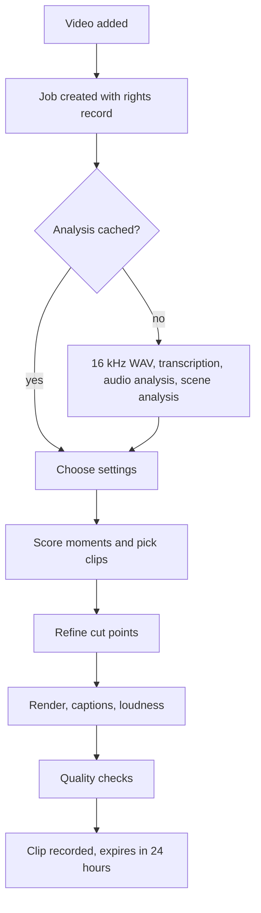

# Architecture

clipforge has two parts: a Python engine with a local API, and a Next.js web UI. They talk over loopback. All state lives in a work folder outside the repo (`~/clipforge-work` by default).

## Job flow

## Processes

One Python process runs FastAPI and three daemon threads:

- **Job worker.** Runs one job at a time, because renders are limited by GPU and RAM. Job state is in SQLite, so restarting requeues running jobs. Finished clips are skipped when a job resumes, and cached analysis is reused.
- **Cleanup.** Every 60 seconds it deletes expired clips and old crash leftovers. A clip that is mid-upload waits for the next pass.
- **Upload worker.** Sends one upload at a time and polls processing status.

## Key decisions

**One analysis pass instead of PySceneDetect and librosa.** FFmpeg pipes tiny gray frames into NumPy, which gives exact cut frames and the motion curve in one pass with flat memory. Audio features come from a memory-mapped WAV.

**Each caption word is its own ASS event.** Inline size changes make libass reflow the whole line, so a popping word would push its neighbours. Separate positioned events keep the other words still. This needs exact text measurement, so layout follows libass's rule that font size means cell height (`winAscent + winDescent`), and tests compare the prediction with real renders.

**Clips with many cuts render one segment at a time.** Each FFmpeg input is a full decoder. A clip with 16 cuts at once got killed for memory on a 7.6 GB machine. Above four segments, each goes to a high-quality temp file, and the files are then joined for captions, loudness and the final encode. Crossfades need all segments open, so those clips use clean cuts and the job says so.

**Encoders are proven, not assumed.** Hardware detection runs real test encodes. On the development machine, H.264 NVENC stops at 4K and HEVC NVENC reaches 8K, so 8K exports use HEVC.

**Polling, not websockets.** There is one user on one machine, so the UI polls.

## Data model

| Table | Holds |
|---|---|
| `Source` | Video file, probe data, whether clipforge owns the copy |
| `Job` | Mode, status, stage, settings, rights record, decisions |
| `Clip` | Timing, exact frame segments, title, description, QC, file paths, expiry |
| `Preset` | Caption style as JSON |
| `Channel` | Platform, link group, defaults, connected state |
| `Upload` | Status, remote ID, claim details and your decision |

Tokens and app secrets are not in the database. They are in `secrets/`, in files with mode 0600.

## Clip selection

1. Words become sentences, using end punctuation or pauses, since Whisper sometimes drops punctuation.
2. Per-second curves are built for speech energy, emotion, topic change and visual action.
3. Each genre weighs the curves differently.
4. Candidates start at a sentence start and end at a sentence end near the target length. If none fit, the allowed range widens: whole sentences matter more than exact length.
5. Scores add a bonus for a strong first three seconds and a penalty for silence.
6. The highest scores win without overlapping, then clips are ordered by time for part numbering.
7. Boundaries pad into silence, snap to a nearby scene cut, and round so a word is never clipped.

Video with little speech uses silences and scene cuts as units, splitting long spans evenly.

## Security

The API binds to `127.0.0.1` and refuses requests with a foreign `Origin` or `Host`. Otherwise any website you visit could send requests to it (CSRF, DNS rebinding). Secrets are write-only through the API. Tokens never go in URLs, and httpx URL logging is silenced.
